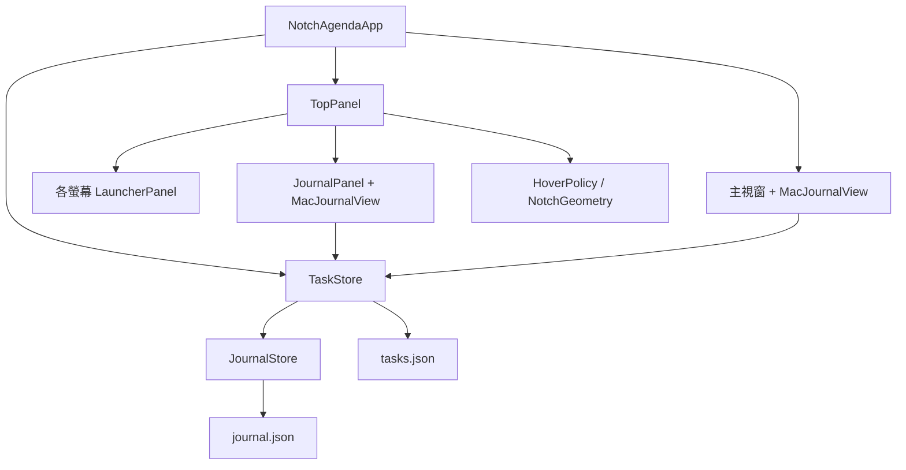

# NotchAgenda 開發指南

## 1. 開發環境與常用命令

- macOS 14+。
- 支援 Swift 6 的完整 Xcode；只有 Command Line Tools 時可能無法載入 XCTest。
- Swift Package Manager；主程式沒有額外第三方套件依賴。
- `project.yml` 僅在需要產生 iOS／Widget Xcode 專案時使用，需另備 XcodeGen。

```sh
# 在 Xcode 開啟 Package.swift，或使用命令列：
DEVELOPER_DIR=/Applications/Xcode.app/Contents/Developer swift build
DEVELOPER_DIR=/Applications/Xcode.app/Contents/Developer swift test

# 建立並啟動 App bundle
./scripts/run-mac.sh

# 只建置，不啟動
./scripts/run-mac.sh --build-only

# 隔離測試資料的 App
./scripts/run-mac.sh --qa
./scripts/run-mac.sh --qa-build-only
```

腳本把 module cache 與 package cache 放在 `.build/`，可減少受限制環境無法寫入使用者快取的問題。它不會全域修改 `xcode-select`。

改碼後先結束舊程序再啟動新 App。腳本用臨時檔及 rename 置換 bundle 中的 executable，但已執行的程序仍然是舊程式。

## 2. 原始碼導覽

| 檔案 | 責任與修改入口 |
| --- | --- |
| `Sources/NotchAgenda/NotchAgendaApp.swift` | App／選單列場景、共用 store、初次背景啟動、主視窗、退出前保存 |
| `Sources/NotchAgenda/TopPanel.swift` | NSPanel、黑色入口、hover timer、釘選、焦點、動畫、多螢幕及生命週期 |
| `Sources/NotchAgenda/NotchHover.swift` | 相機區量測、純幾何 `NotchGeometry` 及純狀態機 `HoverPolicy` |
| `Sources/NotchAgenda/PanelSlideAnimator.swift` | 可中斷的位置／透明度插值與短生命週期動畫 timer |
| `Sources/NotchAgenda/MacJournalView.swift` | 五頁導覽、待辦／已完成／日記切換、輸入、原生 checkbox、移回待辦、月曆、日期安排 |
| `Sources/NotchAgenda/AppPreferences.swift` | 語言、穩定頁面 ID、外觀／紙張、JSON 設定保存與相容 |
| `Sources/NotchAgenda/EnglishStrings.swift` | English UI 字串；繁轉簡使用 ICU 並覆寫常用介面用語 |
| `Sources/NotchAgenda/AppSettingsView.swift` | 語言設定、外表與內頁獨立選擇及即時預覽 |
| `Sources/NotchAgenda/NotebookAppearance.swift` | 配色、封面裝飾及 SwiftUI 環境值 |
| `Sources/NotchAgenda/TaskStore.swift` | 任務模型、時間區間、重複投影、完成、刪除、資料相容及 JSON 保存 |
| `Sources/NotchAgenda/JournalStore.swift` | 文字日記、週期 key、共用草稿、自動儲存 API、日記單步復原 |
| `Sources/NotchAgenda/JournalEditor.swift` | 日記 TextEditor、650ms 儲存、切頁保存、垃圾桶 UI |
| `Sources/NotchAgenda/ContentView.swift` | iPhone／iPad 五個頁面、滑動待辦、安排、垃圾桶與日記 |
| `Widgets/NotchAgendaWidget.swift` | iPhone Widget、共用當期 occurrence 查詢及 App Group 讀取 |
| `Tests/NotchAgendaTests/` | 檔案保存、重複規則、日記、垃圾桶、native UI 整合及 hover 測試 |
| `scripts/run-mac.sh` | Debug App bundle、版本、QA bundle identifier 與資料覆寫 |
| `project.yml` | XcodeGen iOS／macOS／Widget target、App Group 設定 |

修改功能時，先定位對應 store 方法，再改 UI，避免在 SwiftUI View 直接改 JSON。

## 3. 執行架構



Store 在 App 層建立，主視窗與浮動面板共用。NSHostingView 只建立一次，隱藏面板時保留其狀態，未提交的待辦輸入不會因 hover 收起而清空。

`@Observable` 及 UI 操作都在 MainActor。檔案寫入目前同步進行；若未來改為非同步，必須把序列化、版本比對及完成回傳一併設計，避免舊快照蓋過新編輯。

## 4. Hover 的實作與擴充

### 幾何與螢幕座標

`NotchGeometry` 接收 screen frame、visible frame、safe-area top inset 及量測的相機區矩形，產生：

- `triggerFrame`：頂部中央、相機及小黑色入口的觸發區。
- `launcherFrame`：收起時顯示的黑色入口。
- `expandedFrame`：安全區下方的完整面板，限制於可見螢幕。
- `bridgeFrame`：入口與面板間的容許移動區。

全部使用 AppKit 全域螢幕座標，左下角為原點；外接螢幕可能有負 X／Y。不要假設主螢幕在 `(0, 0)`，亦不要將 SwiftUI 左上角座標直接混用。

滑鼠位置由 [`NSEvent.mouseLocation`](https://developer.apple.com/documentation/appkit/nsevent/mouselocation) 取得；它回傳螢幕座標。相機區使用 [`NSScreen.auxiliaryTopLeftArea`](https://developer.apple.com/documentation/appkit/nsscreen/auxiliarytopleftarea) 與右側區域的間距。`cameraFrame` 會辨識全域或 screen-local 輔助區座標；所有數值均為 point，不再乘 Retina backing scale。

有瀏海時，收起窗口寬度等於量測的相機區，從螢幕頂部覆蓋安全區並向下多留 5pt，只在底部畫細提示；展開面板頂邊與相機區底邊相接。相機矩形不可得時，以安全區高度推算 140–220pt 備用寬度。有瀏海的備用值不影響無瀏海分支；後者保持 160×24pt 膠囊與既有位置。

### 狀態機

`HoverPolicy.update` 不接觸 AppKit，輸入包含時間、是否在入口／面板、是否展開及是否受保護，回傳 `.expand`、`.collapse` 或 nil。

| 設定 | 預設 |
| --- | --- |
| 開啟停留延遲 | 0.24 秒 |
| 離開收起延遲 | 0.7 秒 |
| 輪詢週期 | 0.1 秒 |

`TopPanel` 使用 `ProcessInfo.systemUptime`，不受系統時鐘調整影響。Timer 加到主 RunLoop 的 common mode，選單／拖動時仍能維護狀態；保護條件決定是否允許收起。

保護條件：釘選、面板為 key 且 first responder 是 NSTextView、attached sheet／child window、App 內 NSMenu tracking、或滑鼠按鍵仍按住。收起後會等待滑鼠先離開入口，避免原地重開。

目前用低頻 mouse-location 輪詢，不建立 global key event tap，不要求 Accessibility 或螢幕錄製權限。停用 hover 時會停止 timer；退出時 `TopPanel.stop()` 清理 timer、subscriptions 及 launcher windows。

若要改延遲，改 `HoverPolicy` 預設並同步更新測試及使用指南。若改入口形狀，先改 `NotchGeometry` 並以非零／負原點螢幕測試；不要只在 View 加 padding。

### 視窗與焦點

- `LauncherPanel` 不可成為 key/main，`ignoresMouseEvents = true`，避免擋住選單列點擊。
- `JournalPanel` 明確允許成為 key，維持 `.nonactivatingPanel`。
- Hover 展開使用 `orderFrontRegardless()`，不呼叫 activate 或 makeKey。
- 手動叫出使用 `makeKeyAndOrderFront()`，預設釘選。
- 原生 checkbox 與「移回待辦」按鈕接受 inactive panel 的 first mouse。
- 展開以 0.52 秒向下移動並淡入；收起以 0.46 秒向上移動並淡出。Reduce Motion 開啟時省略兩者。
- `transition` generation 與動畫取消機制共同防止舊 completion 把重新展開的面板關掉。
- `NSApplication.didChangeScreenParametersNotification` 處理螢幕增減、解析度及安全區重排。

UI 的 sheet、選單與文字輸入不要繞過保護邏輯自行 `orderOut`。新增關閉入口請呼叫 `TopPanel.collapse()`，它會先保存日記，失敗時保持展開並釘選。

### 可中斷的滑動動畫

`PanelSlideMotion` 是可測試的純插值：使用 smoothstep 曲線，從 `PanelPresentation(frame, opacity)` 移到目標。收回位移為 48–80pt，依相機安全區高度調整；不縮放內容，正常展開／收起期間不改窗口尺寸，避免日記與 TextEditor 重新排版。

`PanelSlideAnimator` 只在轉場期間啟動 60Hz timer，結束／取消後停止。新動畫先取樣舊動畫目前的位置與透明度，取消舊完成回調，再從該位置接續；不重設回起始位置。

`TopPanel.isRetracting` 與 `allowHoverResume` 區分自動收回及手動關閉。自動收回時，滑鼠返回仍可見面板或入口會立即接回展開動畫；Esc／收起按鈕則尊重原本「先離開入口再移回」規則。螢幕重排時會取消進行中的收回，再依新幾何放置入口。

## 5. 任務與重複事項模型

### 主要型別

| 型別／欄位 | 意義 |
| --- | --- |
| `TaskScope` | `.day`、`.week`、`.month`、`.anytime` |
| `TaskRepeat` | `.none`、`.daily`、`.weekly`、`.monthly` |
| `TaskItem.date` | 單次安排或重複系列起點，按 scope 正規化 |
| `TaskItem.completed` | 非重複事項目前狀態 |
| `TaskItem.pendingOccurrences` | 重複事項被移回待辦的期別，不是操作日誌 |
| `TaskRecord` | 完成時文字／時間快照，帶 occurrenceDate 和 scope |
| `TaskOccurrence` | 某日或某週期投影出的 UI 項目及完成狀態 |
| `TaskItem.deletedAt` | 軟刪除時間；nil 表示正常項目 |
| `TaskItem.repeatEnd` | 後續停止的期別界線，歷史仍可查看 |

週界固定週一；月份按 Calendar 的曆月。避免用固定 `86400` 秒推算天數，以免遇到夏令時間。

### 投影而非預先生成

`occurrence(for:on:carryOver:)` 依日期計算一期，`occurrences` 按 scope 篩選。每日、週、月重複只保存一個系列，不建立無限筆 future tasks。

月重複以原起始日號為準，短月份使用月底；不要從上次已截短日期繼續加一個月，否則 1/31 → 2/28 後會漂移成 3/28。

`pendingOccurrences(on:scope:)` 與 `completedOccurrences(on:scope:)` 為兩份 UI 列表提供資料。未來單次事項不混入今天，過期未完成項目可透過 carryOver 留在今天。重複事項漏做的舊期不全部搬到今天。

### 完成流程

```swift
store.setCompleted(entry.task, occurrenceDate: entry.date, completed: true)
store.returnToPending(entry)
```

完成必須指定目標狀態，不在 UI 直接 toggle 舊快照。`setCompleted` 再讀取目前 store，重送相同狀態時不新增資料。

- 完成後移入「已完成」。
- 移回待辦不寫入 restart event。
- 再次完成更新同一事項／期別的完成快照，保留 record ID，數量不增加。
- 重複期別用獨立 pending override 保存狀態，不把整個系列標成永久完成。
- `TaskRecord.Action.reopened` 只用於讀取舊資料；新功能不可再寫入它。

### 刪除與還原

```swift
store.delete(task)
store.restore(task)
```

刪除只設定 `deletedAt`。新增清單、計數或月曆時使用 `activeTasks`／occurrences，避免把垃圾桶項目重新算進去。完成資料可保留在 `tasks`，不代表仍應顯示在待辦清單。

刪除重複系列會隱藏全部投影，還原保持原安排、重複規則及完成狀態。UI 目前沒有永久清除 API。

## 6. 文字日記

`JournalEntry.id` 使用 `scope/era/year-month-day` 的 civil-date key。週、月會先正規化到期首，同一週／月因此共用一份手記。Key 不以 UTC 秒數作為日期身分，避免跨時區後同一民用日期讀不到日記。

```swift
journal.setDraft(text, on: date, scope: .week)
journal.saveDraft(on: date, scope: .week)
journal.flushAllDrafts()
journal.undo(on: date, scope: .week)
```

`JournalEditor` 以文字作 `.task(id:)`，650ms debounce 後保存；新編輯取消舊 task。View 的 period key 改變時換 identity，舊 View 的 `onDisappear` 保存舊日期，避免內容寫到新一天。

草稿放在共用 JournalStore，兩個視窗看到同一份文字。保存失敗不清空草稿。`MacAppDelegate.applicationShouldTerminate` 與 `TopPanel.collapse` 都會 flush；前者失敗取消退出，後者失敗保持展開。

日記事項的單步復原分開管理。新增日記功能時不要挪用 TaskStore 的 `previous`，否則 autosave 會覆蓋事項的復原快照。

## 7. 數據位置、格式與相容

### 正式資料

```text
~/Library/Application Support/FlowTasks/tasks.json
~/Library/Application Support/FlowTasks/journal.json
```

這是刻意保留的 legacy path。改名只改 App／module／bundle，不遷移資料夾。若將來要改到 NotchAgenda 路徑，必須另做有備份、可重試的遷移，不能直接改字串。

`tasks.json` 為 `[TaskItem]`，`journal.json` 為 `[JournalEntry]`，`preferences.json` 為語言／筆記本展示偏好物件。Swift JSONEncoder 的 Date 預設是自 2001-01-01 起的秒數，不是 Unix epoch，也不是可直接顯示的當地時間。

任務欄位示意：

```json
{
  "id": "UUID",
  "title": "Duolingo",
  "scope": "day",
  "recurrence": "daily",
  "date": 0,
  "completed": false,
  "records": [],
  "pendingOccurrences": []
}
```

此為格式示意，`date: 0` 不是建議的使用日期；optional 欄位省略或 nil 代表尚未設定。不要用這段覆蓋使用者資料。

所有保存先建立父資料夾，再 `.write(options: .atomic)`，成功後才更新記憶體與復原快照。檔案無法解碼時停止後續寫入，保留原檔。

目前沒有跨程序鎖；舊版與新版共用資料夾，請不要同時執行兩個正式程序。QA 使用獨立目錄。

### 舊資料讀取

`TaskItem.init(from:)` 負責：

1. 缺少 scope 時，有日期歸 day，無日期歸 anytime。
2. 缺少 deletedAt／pendingOccurrences 時使用向後相容預設。
3. 在移除舊 reopened 事件前，先保存每個重複期別的最新待辦狀態。
4. 將完成紀錄壓到每事項／期別最多一筆。
5. 下一次正常保存才把整理後格式寫入檔案。

新增 Codable 欄位要優先使用 optional 或明確 decodeIfPresent，並新增舊檔 fixture 測試。不要讓升級將舊檔解碼成空清單後覆寫。

### Mac 滑動速度偏好

`HoverSpeed` 於 AppPreferences 定義 fast/medium/slow，以及各自 openingDuration／closingDuration。`preferences.json` 的 hoverSpeed 缺省時解碼為 medium，保留既有 0.52／0.46 秒節奏。TopPanel 每次開始動畫時讀取當前偏好，不重建內容，也不改 HoverPolicy 的停留／離開延遲。減少動態效果仍由原有分支優先處理。Mac 設定以 segmented picker 顯示，iOS 不顯示。

### 語言與筆記本設定

`TaskStore.preferences` 與 `JournalStore.preferences` 共用同一個 AppPreferences。正式檔案為同目錄的 `preferences.json`，獨立於事項／文字日記的復原快照。設定變更成功寫入後才更新可觀察狀態，儲存失敗不假裝切換成功。

`NotebookPage` 使用穩定的 `day/week/month/anytime/calendar` ID，保留原本五個橫向分頁。`NotebookAppearance` 定義 cream/rose/leather/minimal，`NotebookPaper` 定義 ruled/grid/dotted/plain，兩者獨立保存。舊版 notebooks/covers/startsOnShelf 欄位忽略，缺少新欄位時預設 cream/ruled，語言保留。

`NotebookAppearance.palette` 提供外表、內頁、文字、強調色與線條色；`NotebookCoverTrim` 繪製細框、縫線或極簡線條。`MacJournalView` 將 palette 和 paper 注入環境，`RuledPaper` 繪製內頁底紋，日記輸入區亦共用。新增外表時擴充 enum、palette、英文譯文；新增紙張時擴充 enum 及 RuledPaper。保持 View identity，避免外觀切換清掉輸入或當前頁面。

設定檔例子：`{"language":"zh-Hant","appearance":"rose","paper":"dotted"}`。設定不會修改 tasks.json 或 journal.json。

UI 字串使用 `preferences.text(key)`，數量使用 `preferences.format(key, count)`。English 譯文集中在 EnglishStrings；簡體以 Traditional-Simplified transform 加常用按鈕用語覆寫。新增 UI 文字需同步加入 English 對照，不能只新增繁體字面值。不要把使用者的 task.title 或日記 text 傳給翻譯函數。

日期格式明確使用 `.locale(preferences.locale)`；SwiftUI 根 View 注入相同 locale，原生 NSViewRepresentable 按鈕在 updateNSView 中依 context.environment.locale 更新。切語言不重建整個 View identity，避免清掉草稿或閱讀位置。設定儲存後發布 AppPreferences.didChange，更新浮動面板的 native window title。

### 身分與偏好設定

| 項目 | 值 |
| --- | --- |
| Mac bundle | `com.colday.notchagenda.mac` |
| QA bundle | `com.colday.notchagenda.qa` |
| Hover 設定 | UserDefaults `notchagenda.hoverEnabled`，預設 true |
| Debug 資料覆寫 | `NOTCHAGENDA_DATA_FILE`，仍接受 `FLOWTASKS_DATA_FILE` 舊別名 |
| iOS bundle／App Group | `com.colday.notchagenda`／`group.com.colday.notchagenda`；舊 iOS 原型身分不沿用，Mac 資料路徑不變 |

QA bundle 的 LSEnvironment 指向 `.build/qa/tasks.json`，日記使用同目錄 `journal.json`，設定為 `preferences.json`。測試檔名覆寫只在 Debug 建置啟用。

## 8. 如何開發各類功能

### 新增一種目標週期

1. 在 TaskScope 新增 case、title、允許的 repeats。
2. 更新 `TaskStore.interval` 與 `occurrence`。
3. 更新 MacJournalView 的 JournalPage、導覽日期增量及建立選單。
4. 若有週期日記，更新 JournalStore 的 periodStart 和 key，以及 editor 的標題／提示。
5. 加入跨週／年／月界線、完成、移回待辦及舊資料測試。

### 新增重複規則

1. 擴充 TaskRepeat，不只改 Picker。
2. 在 occurrence 投影加入日期匹配，明確定義開始、結束與短月份行為。
3. 保持每期完成 key 穩定；測試完成 A 期不會影響 B 期。
4. 更新 TaskScope.repeats、表單提示及使用指南。

### 修改 checkbox 或拖動

1. 保留 `acceptsFirstMouse`、32pt 點擊範圍及不攔截事件的裝飾層。
2. 不要把整列 DragGesture 包回 checkbox；拖動只綁在把手。
3. 完成只傳入 true；移回待辦只從已完成列表提供。
4. 寫入失敗要還原原生 control 狀態。
5. 跑實際 NSHostingView 的命中與列表轉移整合測試。

### 新增資料、搜尋或同步

先定義 stable ID、修改衝突與刪除語意。軟刪除和各期狀態不能只靠最後一筆日誌推算。加入非同步 I/O／CloudKit 前，需設計跨程序協調及草稿版本，不能直接在 View 加網路請求。

### 調整日記儲存

保留共用草稿、debounce cancellation、切頁 flush、退出前 flush 及寫入失敗保護。不要只在 TextEditor.onDisappear 依賴保存，因程序退出不一定會完整跑 View 生命週期。

## 9. 測試與實機驗證

```sh
DEVELOPER_DIR=/Applications/Xcode.app/Contents/Developer swift test
DEVELOPER_DIR=/Applications/Xcode.app/Contents/Developer swift test --filter NotchHoverTests
DEVELOPER_DIR=/Applications/Xcode.app/Contents/Developer swift test --filter CompletionFlowTests
```

- AppPreferencesTests：三語、字串格式、外表與內頁獨立保存、舊版偏好遷移、資料保留及設定檔錯誤保護。
- NotebookPresentationTests：直接進入原版分頁、外觀切換保留輸入框與草稿、外觀／設定預覽；可用 NOTCHAGENDA_PREVIEW_DIR 輸出測試 PNG。
- CheckboxTests：native 命中、首擊、完成列表轉移、移回待辦、錯誤還原、真實 TextEditor autosave／切頁。
- CompletionFlowTests：重複往返不膨脹日誌、舊日誌整理。
- PlanningTests：未來安排、週月界線、每日／週／月重複、閏月及月底。
- JournalAndTrashTests：刪除／還原、日記分期、備份式重讀、草稿保護、獨立復原。
- TaskStoreTests：批量輸入、保存、相容與損壞檔保護。
- NotchHoverTests：dwell、離開 grace period、保護條件、Esc 抑制、相機量測、不同瀏海寬度、無瀏海尺寸保持、全域／local 負座標及備用幾何。
- PanelSlideTests：位移方向、緩入緩出、固定尺寸、中途反向位置連續、Reduce Motion 零時長，以及舊完成回調取消。

測試使用 temporary directories，不使用正式資料。UI 整合視窗不會前置搶走正在操作的主程式。

實機 QA 另檢查：

1. 三語切換、外表／內頁獨立切換與草稿保留，以及瀏海及無瀏海螢幕的頂部中心停留、移入面板與移開收起。
2. Hover 不搶焦點；點入文字框後能正常輸入中文。
3. 選單、日期 picker、sheet、釘選、拖動及 Esc。
4. 接上／拔除外接螢幕、不同縮放、負座標及休眠喚醒。
5. 全螢幕、Spaces、Mission Control、自動隱藏選單列及 Reduce Motion。
6. 關閉主視窗後 hover 仍運作；退出後所有入口消失。

自動測試驗證策略及幾何，不代表已在所有相機硬體、系統空間與螢幕組合完成實機驗證。

## 10. 建置與發佈

Swift package／module 名稱為 NotchAgenda，source 為 `Sources/NotchAgenda`，tests 為 `Tests/NotchAgendaTests`。`scripts/run-mac.sh` 建立 App Info.plist，管理目前版本與 QA bundle。

iOS／iPadOS 建置、測試、封存與 TestFlight 發佈步驟見 [IOS_RELEASE.md](IOS_RELEASE.md)。`project.yml` 定義 App、Widget、共用單元測試與 iOS 介面測試。`scripts/build-ios.sh` 產生專案並呼叫 Xcode；生成的 xcodeproj 不提交，Config、Resources 與 project.yml 才是來源。

`TaskStore.widgetOccurrences(on:)` 共用日／週／月／待完成的當期查詢，Widget 不自行用 completed 布林過濾重複事項。Widget 為唯讀，App 使用原子寫入並要求重載 timeline；系統決定實際更新時機。iOS App、Widget 共用 group.com.colday.notchagenda 的 JSON，未加入網路同步。AppIcon 與 PrivacyInfo.xcprivacy 位於 Resources。

UI 測試以 `-ui-testing` 與 UUID 型 NOTCHAGENDA_TEST_STORE 選用獨立暫存目錄，僅 Debug 生效。可驗證重啟保存，不接觸使用者資料。`MobileFlowTests` 驗證批量輸入、完成／移回待辦、刪除／還原、每日重複及設定／日記重啟保存。

目前本機 bundle 並未完成 Developer ID 簽署、公證或自動更新。正式發佈前需另做 signing、notarization、圖示、安裝／更新流程及實機驗證；不要把本機 Debug bundle 當作已驗證的正式發行版。
